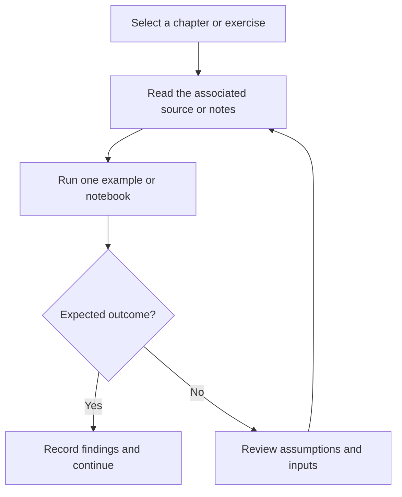

# Data Science, Machine Learning, Deep Learning, and NLP

Learning archive of Python, statistics, machine learning, deep learning, NLP, deployment, and project exercises.

## Project focus

Learning notes and notebooks. Use the directory map to choose a focused example or learning topic instead of treating the repository as one application.

## Workflow



The diagram describes how to work through the material; it is not a deployed service topology.

## Repository structure

| Path | Purpose |
| --- | --- |
| [`10_Data_Analysis_with_Python/`](10_Data_Analysis_with_Python) | Topic-organized learning material and examples. |
| [`11_SqlLite/`](11_SqlLite) | Topic-organized learning material and examples. |
| [`12_logging_in_python/`](12_logging_in_python) | Topic-organized learning material and examples. |
| [`13_multi-threading and multi-processing/`](13_multi-threading%20and%20multi-processing) | Topic-organized learning material and examples. |
| [`14_Memory Allocation  and Memory Management/`](14_Memory%20Allocation%20%20and%20Memory%20Management) | Topic-organized learning material and examples. |
| [`15_Flask/`](15_Flask) | Topic-organized learning material and examples. |
| [`16_streamlit_app/`](16_streamlit_app) | Topic-organized learning material and examples. |
| [`17_statistics/`](17_statistics) | Topic-organized learning material and examples. |
| [`18_Probability/`](18_Probability) | Topic-organized learning material and examples. |
| [`19_Machine Learning/`](19_Machine%20Learning) | Topic-organized learning material and examples. |
| [`1_1.1 Basic_Python/`](1_1.1%20Basic_Python) | Topic-organized learning material and examples. |
| [`1_1.2 Array/`](1_1.2%20Array) | Topic-organized learning material and examples. |
| [`20_docker/`](20_docker) | Topic-organized learning material and examples. |
| [`22_End-to-End Projects/`](22_End-to-End%20Projects) | Topic-organized learning material and examples. |
| [`2_Control Flow/`](2_Control%20Flow) | Topic-organized learning material and examples. |
| [`3_inbuilt_in Python Data Structures/`](3_inbuilt_in%20Python%20Data%20Structures) | Topic-organized learning material and examples. |
| [`4_Functions in python/`](4_Functions%20in%20python) | Topic-organized learning material and examples. |
| [`5_Import_Modules&Packages/`](5_Import_Modules%26Packages) | Topic-organized learning material and examples. |
| [`6_File_Handling/`](6_File_Handling) | Topic-organized learning material and examples. |
| [`7_exception_handling/`](7_exception_handling) | Topic-organized learning material and examples. |
| [`8_OOP_Concept/`](8_OOP_Concept) | Topic-organized learning material and examples. |
| [`9_Advance Python/`](9_Advance%20Python) | Topic-organized learning material and examples. |
| [`annual-enterprise copy.csv`](annual-enterprise%20copy.csv) | Dataset, fixture, state, or database file; inspect its schema before use. |
| [`annual-enterprise.csv`](annual-enterprise.csv) | Dataset, fixture, state, or database file; inspect its schema before use. |
| [`example.csv`](example.csv) | Dataset, fixture, state, or database file; inspect its schema before use. |
| [`example.txt`](example.txt) | Project-specific source, resources, or learning material. |
| [`guide.txt`](guide.txt) | Project-specific source, resources, or learning material. |
| [`main.py`](main.py) | Program or workflow entry point. |
| [`requirements.txt`](requirements.txt) | Python dependency manifest. |
| [`tempCodeRunnerFile.py`](tempCodeRunnerFile.py) | Python application helper or learning example. |
| [`test.py`](test.py) | Python application helper or learning example. |

## Getting started

```bash
git clone https://github.com/Raimal-Raja/DataScience-ML-DL-NLP.git
cd DataScience-ML-DL-NLP
```

```bash
python -m venv .venv
source .venv/bin/activate
```

On Windows PowerShell, activate the environment with `.venv\Scripts\Activate.ps1` instead.

```bash
python -m pip install -r requirements.txt
```

Open one `.ipynb` file in Jupyter, VS Code, Kaggle, or Colab. Read its dependency and dataset cells before execution. Notebook paths and model/data requirements vary; this repository is not one shared deployable application.

## Verification

Use the setup commands and inspect the selected interface, example, or notebook with known inputs. This documentation review checks repository paths and dependency declarations; it does not claim fresh end-to-end execution or model-quality measurements.

## Contributing

Include reproduction steps, the affected path, expected behavior, and the checks you ran. Keep credentials, generated environments, and unnecessary build artifacts out of commits.

## License

No top-level license file is currently tracked. Check reuse permissions with the repository owner.
